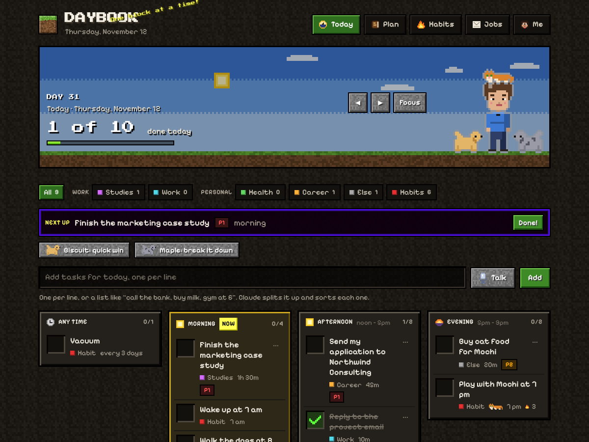
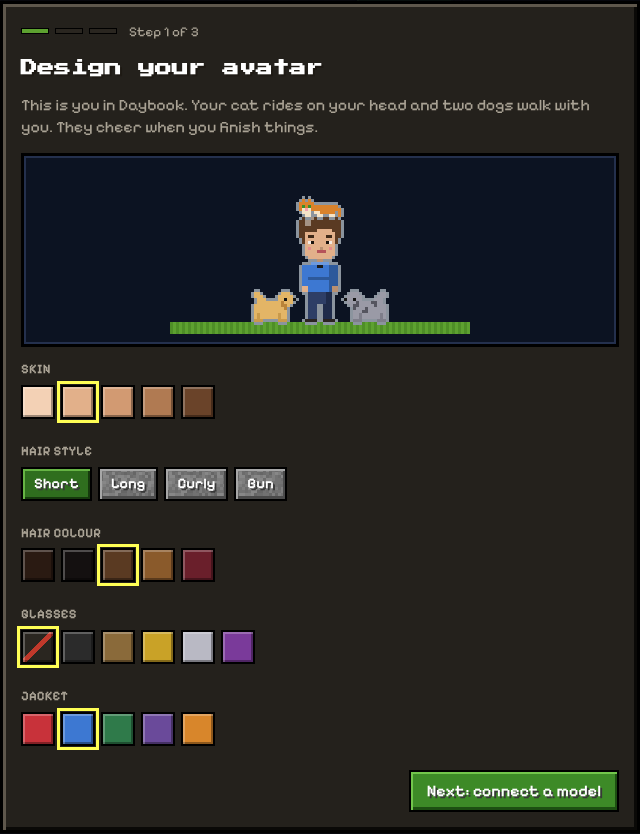
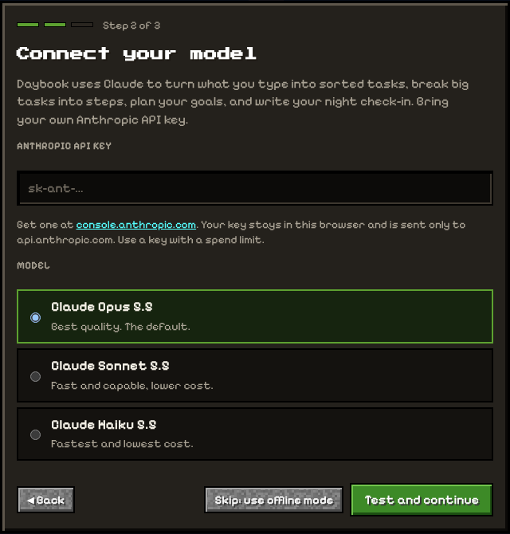
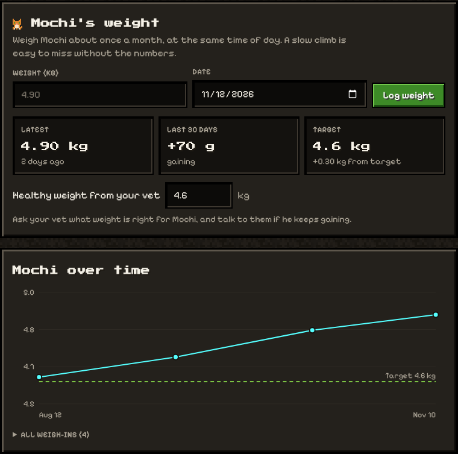
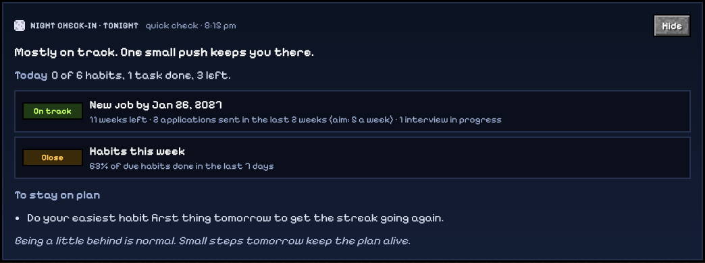
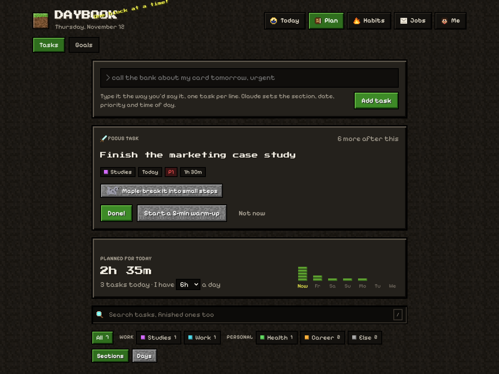
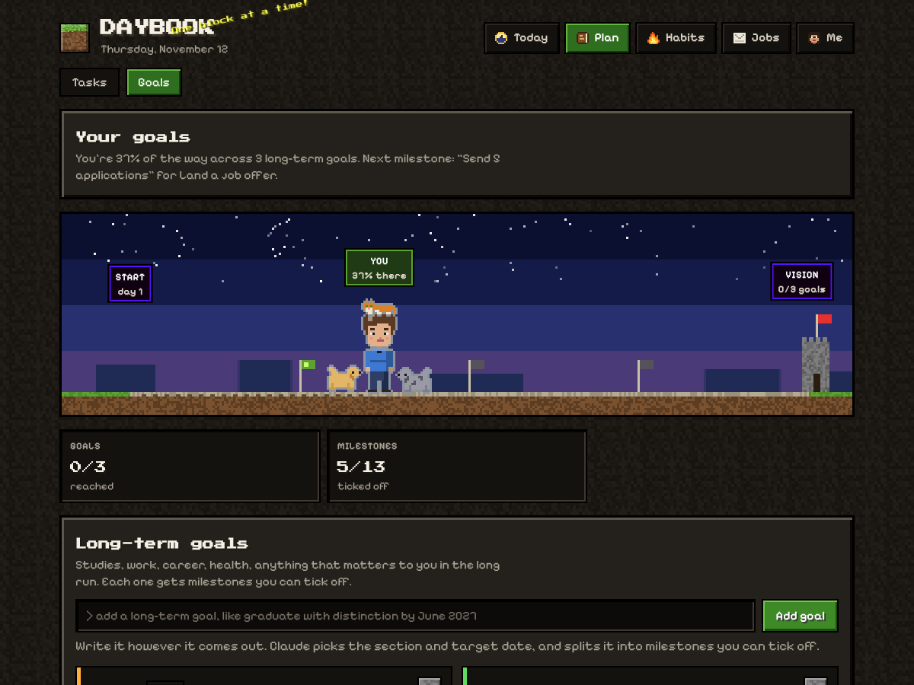
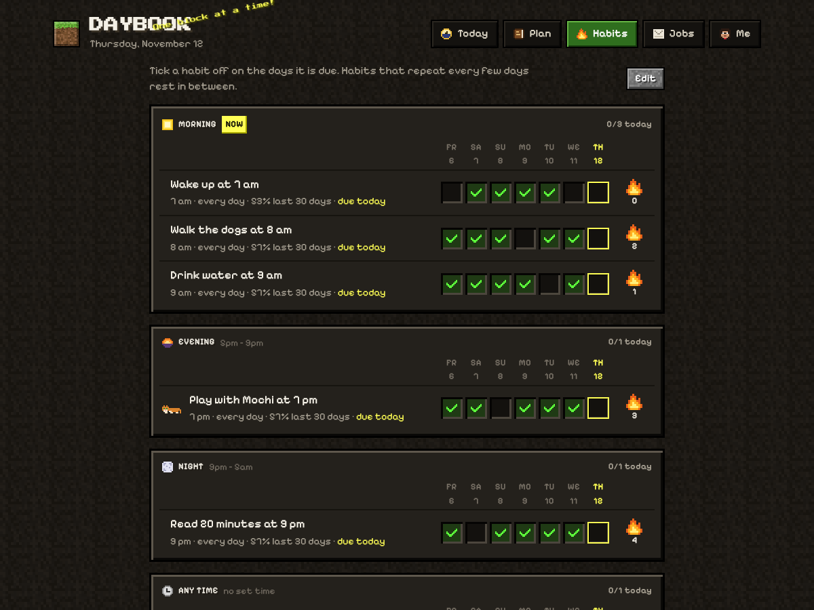
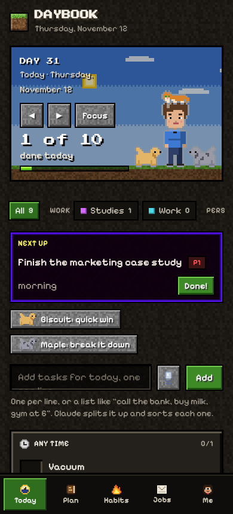

# Daybook

An ADHD-friendly planner in pixel art. Type your tasks the way you think them, or just say them, and Claude sorts each one into a section, a day, a priority and a time of day. Habits, long-term goals, job applications and your cat's weight live in the same calm little world, with a cat called Mochi on your head and two dogs, Biscuit and Maple, who cheer when you finish things.

This is a **public demo**. It ships with made-up sample data and runs entirely in your browser.



## Try it

**Online:** turn on GitHub Pages for this repository (Settings → Pages → Deploy from a branch → `main`, root), then open `https://<your-username>.github.io/Daybook/`.

**Locally:**

```bash
python3 -m http.server 8000
# open http://localhost:8000
```

Opening `index.html` straight from disk works in offline mode, but connecting Claude needs a local server, because browsers block loading the SDK module from `file://`.

## First run: three steps

| 1. Design your avatar | 2. Connect your model |
|---|---|
|  |  |

1. **Design your avatar.** Skin, hair, glasses and jacket. Your crew comes with you.
2. **Connect your model.** Paste your own Anthropic API key and pick a model, or skip and use offline mode.
3. **Start.** Load the sample data to look around, or start empty.

You can change the model, remove the key, replay the intro or reset the demo any time in **Me → Profile**.

## What's inside

- **Today.** One "next up" task, a "3 of 7 done today" bar, filters by section, and a box that takes several tasks at once (one per line, or a list Claude splits up). Biscuit fetches a quick win and Maple breaks a big task into small steps.
- **Talk to Daybook.** Press **Talk** (or T) and say what changed: what you finished, what is not happening any more, what to add or move. Claude turns it into a list of changes (add, update, complete or remove tasks, add or remove habits, log a weigh-in) and nothing is saved until you tick the ones you want. One tap undoes the lot.
- **Night check-in.** From 7 pm, a short check on your plan: on track or behind for each deadline (a new job, weight targets, habits this week), and what to do tomorrow to stay on plan. The verdicts are calculated from your data; Claude writes the words around them. If your last weigh-in is more than a week old, it says so instead of guessing your pace.
- **Plan.** Every task by section, with search, priorities and a detail sheet with steps. Long-term goals with milestones on a road your character walks.
- **Habits.** Daily or every few days, ordered by time of day, with streaks and a 12-week heatmap.
- **Jobs.** A board from "want to apply" to "offer".
- **Me.** Your weight, your cat's weight, your character (skin, hair style and colour, glasses, jacket), your plan deadlines, what matters most to you, and achievements.
- **Focus mode.** Freezes the pets and hides their chatter while you work (press F).

| Talk to Daybook | Your cat's weight |
|---|---|
|  |  |
| **Night check-in** | **Plan** |
|  |  |
| **Goals** | **Habits** |
|  |  |

<p></p>

### About voice

Talk uses the browser's built-in speech recognition (Chrome, Edge and Safari). Where the microphone isn't available, the box still works with typing, or with the dictation key on your phone's keyboard. Without a Claude key, **Add as new tasks** adds each line as a task instead.

## Model and credits

- **AI by [Claude](https://www.anthropic.com/claude) from Anthropic.** Pick Claude Opus 5.5 (the default), Claude Sonnet 5.5 or Claude Haiku 5.5 during setup.
- Calls go straight from your browser to `api.anthropic.com` through the official [Anthropic TypeScript SDK](https://github.com/anthropics/anthropic-sdk-typescript) (`@anthropic-ai/sdk` 0.135.0), bundled for the browser in `vendor/`. Requests use low effort, since the tasks are short. On Opus and Sonnet they also opt into server-side refusal fallbacks.
- Without a key, a built-in quick parser sorts your tasks, and the night check-in uses a template.

## Privacy

- Your tasks, habits, goals, weigh-ins and settings are saved in your browser's `localStorage`. There is no server.
- Your API key is saved in the same place and is sent only to `api.anthropic.com`. Anyone with access to your browser profile could read it, so use a key with a spend limit, and remove it in **Me → Profile** when you're done.
- With a key connected, the text needed for each request (a new task, what you said to Talk along with your open task list, a goal, the day's numbers for the night check-in) is sent to Claude.
- Speech recognition is done by your browser; some browsers send the audio to their own speech service.

## Files

| Path | What it is |
|---|---|
| `index.html` | The whole app: markup, styles and script in one file, with no build step |
| `vendor/anthropic-sdk-0.135.0.mjs` | The official Anthropic SDK, bundled for the browser |
| `vendor/THIRD_PARTY_NOTICES.txt` | Licenses for everything in that bundle |
| `screenshots/` | The images in this README |

### Rebuilding the SDK bundle

```bash
npm install @anthropic-ai/sdk@0.135.0 esbuild
node -e '
require("esbuild").build({
  entryPoints: ["node_modules/@anthropic-ai/sdk/index.mjs"],
  bundle: true, format: "esm", platform: "browser", target: "es2020", minify: true,
  outfile: "vendor/anthropic-sdk-0.135.0.mjs",
  plugins: [{ name: "node-stub", setup(b) {
    b.onResolve({ filter: /^node:/ }, a => ({ path: a.path, namespace: "node-stub" }));
    b.onLoad({ filter: /.*/, namespace: "node-stub" }, () => ({ contents: "export default {};" }));
  } }]
})'
```

Node built-ins are stubbed because the SDK only reaches them when it looks for credentials on disk, which never happens when you pass an API key.
